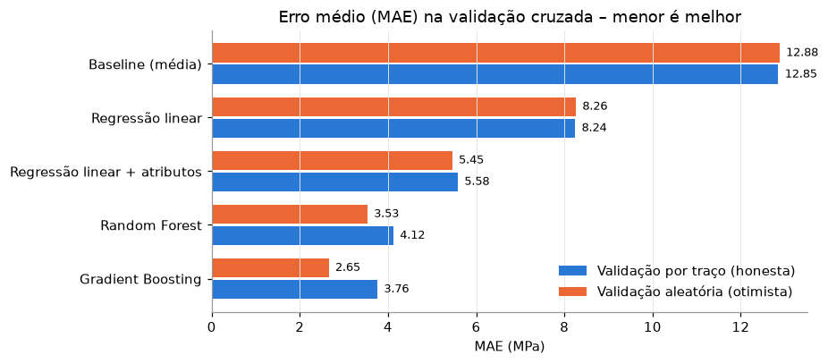
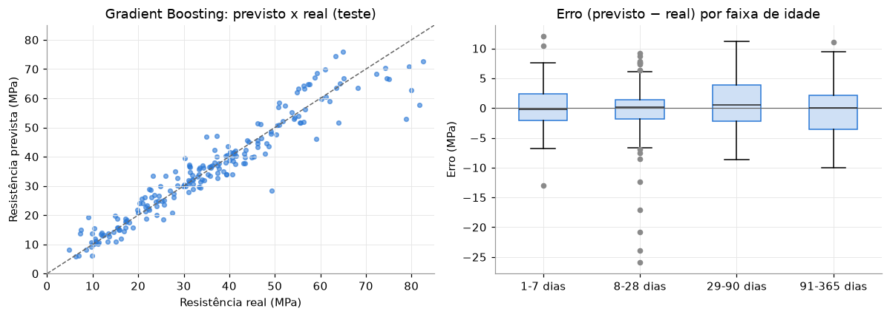

# 🧱 Previsão da Resistência à Compressão do Concreto

Projeto N3 – Aprendizagem de Máquina · Engenharia de Software · Católica SC

Modelo de Machine Learning que estima a **resistência à compressão do concreto (MPa)** a partir da composição da
mistura e da idade, com uma demonstração interativa em Streamlit.

## Objetivo

A resistência do concreto é medida rompendo corpos de prova em laboratório, normalmente aos 28 dias. Quem testa um
novo traço espera semanas pelo resultado. Este projeto estima a resistência **antes do ensaio**, a partir de:

| Entrada | Unidade |
|---|---|
| Cimento, escória de alto-forno, cinza volante, água, superplastificante, agregado graúdo, agregado miúdo | kg/m³ |
| Idade | dias (1 a 365) |

**Quem usaria:** concreteiras, laboratórios de controle tecnológico e engenheiros, para comparar traços e priorizar
ensaios. A confirmação da resistência continua a depender do ensaio de laboratório.

## Dataset

**Concrete Compressive Strength** – I-Cheng Yeh (1998), UCI Machine Learning Repository, id 165 (licença CC BY 4.0).
<https://archive.ics.uci.edu/dataset/165/concrete+compressive+strength>

1.030 ensaios de laboratório, 8 variáveis de entrada e nenhum valor ausente. A versão em CSV está em `data/concrete.csv`.

> Yeh, I-C. *Modeling of strength of high-performance concrete using artificial neural networks.*
> Cement and Concrete Research, 28(12), 1797–1808, 1998.

## Como executar

Use Python 3.12 a 3.14. A entrega foi validada com Python 3.14.

```bash
git clone https://github.com/Yurijpereira/N3_Previsao_Resistencia_Concreto.git
cd N3_Previsao_Resistencia_Concreto
python -m venv .venv
source .venv/bin/activate
python -m pip install -r requirements.txt

# 1) Treinar e avaliar (gera models/modelo.joblib e os relatórios de métricas)
python -m src.treinar

# 2) Demonstração interativa
python -m streamlit run app.py

# 3) Previsão pela linha de comando
python -m src.prever --cimento 350 --agua 175 --superplastificante 6 --idade 28
```

No PowerShell, use `.venv\Scripts\Activate.ps1` no lugar do comando de ativação acima.
A [análise completa](notebooks/01_analise_e_modelagem.ipynb) inclui os gráficos, a avaliação e exemplos de previsão. Para regenerar também as figuras, execute todas as células do notebook.
O app treina o modelo na primeira abertura se o arquivo ainda estiver ausente.

## Estrutura

```
concrete-strength-ml/
├── app.py                         # Demonstração em Streamlit
├── data/concrete.csv              # Dataset (UCI)
├── notebooks/
│   └── 01_analise_e_modelagem.ipynb   # Exploração, modelagem, avaliação e conclusões
├── src/
│   ├── dados.py                   # Leitura, limpeza e engenharia de atributos
│   ├── modelos.py                 # Modelos e estratégia de validação
│   ├── treinar.py                 # Treino, avaliação e salvamento do modelo
│   └── prever.py                  # Função de previsão (usada pelo app e pela linha de comando)
├── models/                        # Modelo treinado (gerado por src.treinar)
├── reports/                       # Métricas, previsões do teste e figuras
└── requirements.txt
```

## Metodologia

**Tratamentos**
- Remoção de 25 duplicatas exatas para evitar peso extra de ensaios repetidos.
- Zeros mantidos: indicam que o aditivo não foi usado, não são dados ausentes.
- Atributos de engenharia: **relação água/cimento** (lei de Abrams), **relação água/aglomerante** e **log da idade**.
- Padronização apenas nos modelos lineares. A padronização e a criação de atributos ficam nos pipelines que as utilizam.

**Validação por traço.** A base limpa contém 427 composições distintas. O mesmo traço pode ser ensaiado em várias idades.
O `GroupShuffleSplit` reserva cerca de 20% dos traços para o teste, ficando 800 ensaios para treino e 205 para teste sem traços em comum.
A exploração usa o conjunto de treino. A escolha do modelo usa o MAE de cinco folds agrupados por traço (`GroupKFold`).

**Modelos comparados:** baseline (média), regressão linear, regressão linear com atributos, Random Forest e
Gradient Boosting.

## Resultados

| Modelo | MAE validação por traço (MPa) | MAE validação aleatória (MPa) | MAE teste (MPa) | R² teste |
|---|---|---|---|---|
| Baseline (média) | 12,85 | 12,88 | 14,40 | 0,00 |
| Regressão linear | 8,24 | 8,26 | 8,48 | 0,64 |
| Regressão linear + atributos | 5,58 | 5,45 | 5,57 | 0,83 |
| Random Forest | 4,12 | 3,53 | 3,99 | 0,90 |
| **Gradient Boosting** | **3,76** | 2,65 | **3,48** | **0,91** |



**Principais conclusões**
- O **Gradient Boosting** prevê a resistência de misturas novas com erro médio de **3,5 MPa** e **R² = 0,91** no teste,
  contra 14,4 MPa da baseline. 75% das previsões erram menos de 5 MPa.
- Os atributos de engenharia reduziram o erro da regressão linear de 8,2 para 5,6 MPa sem trocar de algoritmo.
- O MAE do Gradient Boosting foi de 2,65 MPa na validação aleatória e 3,76 MPa na validação por traço.
  A diferença mostra o efeito de avaliar por linhas em uma base com composições repetidas.
- Variáveis mais importantes: cimento, idade, escória e água, o que é coerente com a engenharia de concreto.
- O app mostra uma **faixa empírica** com margem de aproximadamente 5,8 MPa, estimada na validação por traço.
  A faixa cobriu 81% das medições no teste. Depois da avaliação, o modelo da demonstração foi ajustado com todos os
  ensaios disponíveis. A cobertura de 81% se refere ao teste anterior a esse ajuste.



## Erros e limitações

- Nos 20 ensaios de teste **acima de 60 MPa**, o MAE foi de **8,21 MPa** e a previsão ficou, em média, **4,87 MPa abaixo** da medição. Nas demais faixas, o MAE variou de 1,99 a 3,91 MPa.
- Os dados são de laboratório. O uso com materiais locais exige validação adicional.
- Faltam variáveis relevantes: tipo de cimento, tipo de agregado, cura e temperatura.
- O app limita os controles às faixas observadas. A função e o CLI avisam quando um valor fica fora dessas faixas.

## Demonstração na apresentação

Abra o Streamlit, mantenha a composição e compare as estimativas aos 28 e aos 90 dias. Explique o resultado em MPa e por
que separar os traços na avaliação importa. Cada integrante pode explicar brevemente a própria contribuição.

## Tecnologias

Python · pandas · NumPy · scikit-learn · matplotlib · Streamlit · Jupyter
